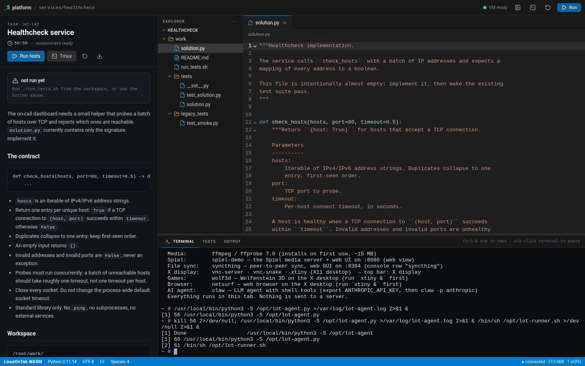

# Two Files — browser debugging interview



A self-contained, local-first interview environment:

- **left**: the task statement;
- **right**: a VS Code-like workspace — file explorer, CodeMirror editor, tabs,
  integrated terminal;
- **under the hood**: a real Linux kernel compiled to WebAssembly
  ([LinuxOnTab](https://linuxontab.com)), Python 3.11, a tiny in-guest agent,
  and a prebuilt rootfs overlay.

Everything runs in the browser tab. There is no application server, no Docker
daemon in the loop, and no code leaves the machine. The first visit downloads
the pinned VM assets and the golden rootfs overlay; the overlay is cached by
the browser, and later visits boot much faster.

The VM is **our own vendored copy** under `public/vm/`, served by the same
origin as the app. It is not an iframe pointing at `next.linuxontab.com`. The
upstream public repo (`kilian-ai/linuxontab`) contains the v1/v86 shell, not
the 2.0 WASM page, so the 2.0 build is pinned here; `scripts/vm-server.mjs`
serves it locally for the overlay builder, and nginx serves the same files in
production.

The interview itself is the “two files” exercise: tests exist, the solution is
empty, and the environment has five planted problems. The candidate has to
debug the environment, get the acceptance suite running, and implement a small
healthcheck function.

> Interviewer material (the five bugs, scoring, timing) lives in
> [`docs/interviewer.md`](docs/interviewer.md). Do not show it to candidates.

## Run locally

```sh
npm install
npm run dev
# http://localhost:5173
```

Requirements: a Chromium-based browser with WebAssembly and
`SharedArrayBuffer`. The Vite dev server sets the COOP/COEP headers.

The committed overlay in `public/overlays/` is the golden image. If you change
the challenge, you do **not** need to rebuild it — the workspace files and the
breakages are written into the guest at boot.

## How it works (short version)

```
React app (task, explorer, CodeMirror)
  │  same-origin iframe
  ▼
LinuxOnTab WASM Linux  ──  /root/work/{solution.py, tests/, run_tests.sh}
  ▲
  │  JSON over a synthetic TCP connection (window.guestAgentCall)
  └── vm/lot-agent.py: read/write/exec/spawn
```

- The overlay is a committed ext4 dirty-block image (`public/overlays/`). The
  app seeds it into IndexedDB under `lot-images` and boots
  `?image=@swe-base`.
- The iframe is same-origin and inherits cross-origin isolation from the top
  page. Both the app and the VM are served with COOP/COEP.
- The guest agent listens on port 45999. The page connects to it through the
  in-page slirp, so editor saves and “Run tests” do not have to type into the
  terminal.
- The five breakages are applied by `src/lib/provision.ts` after boot: a broken
  CI interpreter, a runner pointed at the old smoke tests, a stale test-local
  `solution.py` symlink, a `sitecustomize` socket hook, and a rogue listener on
  the “down” port.

More detail: [`docs/architecture.md`](docs/architecture.md).

## Build the golden overlay

Only needed when you change the base image (Python/tmux/nano, the guest agent,
or the LinuxOnTab assets). The result is committed.

```sh
npm run fetch:packages          # downloads pinned tarballs into vendor/ (gitignored)
npx playwright install chromium # or set CHROME_PATH
npm run build:overlay
```

The script boots `public/vm/`, installs `python3`, `tmux`, `nano` from the
local package set, fetches `vm/lot-agent.py`, starts it, commits the ext4
dirty blocks, pushes them to the local build server, and gzips the result to
`public/overlays/swe-base.data.gz`. The metadata (`swe-base.json`) must stay
next to it.

The overlay is tied to the `rootfs-lean.manifest.json` shipped in
`public/vm/linux-dist/`. If you replace the vendored VM assets, rebuild the
overlay.

## Deploy

The included `Dockerfile` builds the static site with nginx and the
COOP/COEP headers the WASM kernel requires. `docker-compose.yml` joins the
existing `proxy` network and advertises the Caddy label.

On the Docker host:

```sh
docker compose up -d --build
docker compose logs -f
```

The Caddy instance from `~/git/konovalov-nk/caddy-proxy-network` discovers the
label and gets the certificate. The public edge also needs a route (DNS for
`swe-interview-example.br11k.dev` already points at the Hetzner edge):

```sh
~/git/konovalov-nk/caddy-proxy-network/scripts/expose-public-route \
  swe-interview-example.br11k.dev \
  --project swe-interview-example \
  --owner archvm \
  --apply-edge \
  --verify
```

`--apply-edge` updates HAProxy on Hetzner with a timestamped backup and
restarts only `haproxy-edge`. The verify step waits for Caddy ACME.

### Why not GitHub Pages?

GitHub Pages cannot set `Cross-Origin-Opener-Policy` /
`Cross-Origin-Embedder-Policy`, and the WASM kernel needs
`SharedArrayBuffer`. Use a host that supports headers (nginx, Caddy,
Cloudflare Pages with `public/_headers`, Netlify) or put the app behind the
Caddy proxy. A service-worker shim exists in the vendored page, but it is not
a substitute for real headers in every browser.

## The challenge

`challenge/senior/` contains the task statement, the acceptance tests, the
stub, and the old smoke tests. The runtime copy is written to `/root/work` in
the guest at boot. The tests are the spec; the hidden grader should run a
pristine copy against the candidate's `solution.py` so editing tests cannot
turn a broken implementation green.

Expected solution (~15 lines, stdlib only):

```python
import socket
from concurrent.futures import ThreadPoolExecutor


def check_hosts(hosts, port=80, timeout=0.5):
    unique = list(dict.fromkeys(hosts))
    if not unique:
        return {}

    def probe(host):
        try:
            with socket.create_connection((host, port), timeout=timeout):
                return host, True
        except (OSError, ValueError, OverflowError):
            return host, False

    with ThreadPoolExecutor(max_workers=min(32, len(unique))) as pool:
        return dict(pool.map(probe, unique))
```

## Tmux fallback

The top bar’s **Tmux** button starts a three-window session inside the real
terminal:

- `Ctrl-B 1` — shell in `/root/work`
- `Ctrl-B 2` — `nano` (with a small Python syntax file)
- `Ctrl-B 3` — Python REPL

The CodeMirror editor is the primary UX; tmux is there for candidates who
prefer a terminal-only workflow, and as a fallback if the editor pane is not
enough.

## Layout

```
challenge/senior/          task, tests, stub, legacy smoke tests
docs/                      interviewer notes and architecture
public/vm/                 pinned LinuxOnTab WASM page + assets
public/overlays/           committed golden overlay (meta + .data.gz)
scripts/                   overlay builder and local VM server
src/                       React app, CodeMirror, VM bridge, provisioning
vm/lot-agent.py            guest-side JSON agent
```

## Credits

- [LinuxOnTab](https://linuxontab.com) — real Linux 7.1 compiled to
  WebAssembly, the in-page slirp, and the package format. The vendored page is
  pinned under `public/vm/`.
- [xterm.js](https://xtermjs.org/), [CodeMirror](https://codemirror.net/),
  [React](https://react.dev/), [Vite](https://vite.dev/).
- Alpine/WASM package toolchain from the LinuxOnTab packages index.

This is an interview demo, not a hardened multi-tenant service. Treat the VM as
a browser sandbox; do not put production secrets in it.
